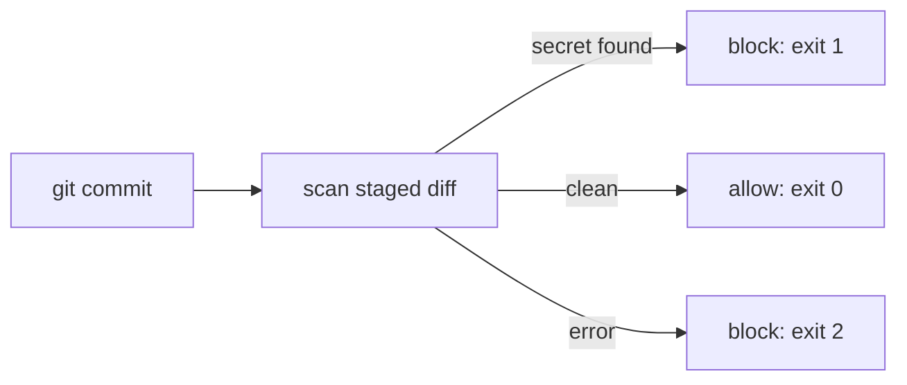

# repo-guard

Block secrets before they reach GitHub: a deterministic, offline pre-commit scanner for staged Git content.

[](https://github.com/MilJav11/repo-guard/actions/workflows/tests.yml)

[](LICENSE)
[](https://github.com/MilJav11/repo-guard/releases)

https://github.com/user-attachments/assets/dd57abc2-b434-4cdd-b640-99add1edd382

## Quick start

Requires Python 3.11+ and Git.

**1. Install** (`pipx` recommended; `pip` works too):

```bash
pipx install git+https://github.com/MilJav11/repo-guard.git
# or: pip install git+https://github.com/MilJav11/repo-guard.git
```

**2. Activate the hook** inside any Git repository:

```bash
cd /path/to/your/repo
repo-guard install-hook
```

**3. Try it.** The test value is generated at run time, so this README contains nothing that looks like a key:

```bash
printf 'OPENAI_API_KEY="sk-proj-%s"\n' "$(printf 'a1b2c3d4e5%.0s' 1 2 3 4)" > temp_test_file.py
git add temp_test_file.py
git commit -m "test"                  # blocked
git rm -f -q temp_test_file.py        # clean up
```

<details><summary>Windows (PowerShell)</summary>

```powershell
Set-Content temp_test_file.py ('OPENAI_API_KEY="sk-proj-' + ('a1b2c3d4e5' * 4) + '"')
git add temp_test_file.py
git commit -m "test"
git rm -f -q temp_test_file.py
```
</details>

The hook records the absolute path of the Python interpreter that installed it, so it does not depend on `PATH` or on files in your repository. If that interpreter or the package is later removed, commits are **blocked** with a message telling you to reinstall; run `repo-guard install-hook` again to refresh the hook in place (a `pre-commit.bak.*` backup is kept).

## What it catches

**Blocking providers:** OpenAI, Anthropic, Google Gemini, Groq, GitHub, AWS, Stripe Live.

* **Scanned:** every staged file that is added, copied, modified or renamed, read from the Git index, including `tests/` and `fixtures/`.
* **Skipped:** binary files (null byte), files over 1 MB, `__pycache__`, `node_modules`, `venv`, `.venv`, `dist`, `build`, `.sqlite`, `.db`, `.pyc`, `package-lock.json`, `yarn.lock`.
* **`.env` files** print a warning but are still scanned. **LOW severity** (printed, not blocking): generic passwords and keys containing a testing keyword such as `test` or `example`.

## How it works



* **Staged only:** scans the index (`git diff --cached`), never the working tree.
* **Deterministic:** pre-compiled regex rules; no AI, ML or entropy scoring.
* **Offline:** no API calls, telemetry or tracking.
* **Fail-closed:** scanner errors, Git errors and Git timeouts (30 s) block the commit.
* **Existing hooks are kept:** an existing `pre-commit` hook is backed up and the repo-guard section is appended between `# repo-guard hook start` / `# repo-guard hook end` markers. Make sure the existing hook does not `exit` before the end of the file.

## Configuration

An optional `allowlist.json` in the repository root skips your own synthetic test data. Without it the allowlist is empty (`{"paths": [], "patterns": []}`).

```json
{
  "paths": ["tests/fixtures/", "docs/example-config.md"],
  "patterns": ["pragma: allowlist secret"]
}
```

* `paths`: path prefixes relative to the repository root, with forward slashes; matching staged files are skipped entirely.
* `patterns`: Python regexes matched against each **line** of file content (not the file name). A matching line is excluded from detection, including any real secret on the same line, so keep patterns narrow.

This repository's own `allowlist.json` lists only the three test files that contain synthetic keys.

<details><summary>Validation rules and ReDoS scope</summary>

| Rule | Limit |
|---|---|
| Maximum file size | 64 KiB |
| Top-level JSON structure | object with `"paths"` and `"patterns"` keys |
| Key types | both values must be lists of strings |
| Maximum pattern length | 256 characters |
| Regex validity | invalid regex syntax → commit blocked |
| ReDoS defence | selected dangerous nested-quantifier patterns (e.g. `(a+)+b`) are rejected |

Any validation failure is a configuration error (exit code 2) and blocks the commit. The scanner applies a deterministic static check for nested quantifiers such as `(a+)+b` and `(x|x+)+y`. This is a conservative defence against a known class of catastrophic backtracking, **not** a complete ReDoS solution. Keep custom patterns short and simple.

</details>

## Exit codes

**0** no blocking findings · **1** blocking secret detected (commit blocked) · **2** scanner, Git or configuration failure (fail-closed block).

Example output:
```plaintext
[CRITICAL] OpenAI API key detected
File: temp_test_file.py
Line: 1

[CRITICAL] Blocking findings detected. Commit blocked.
```

## Using with pre-commit, core.hooksPath or husky

`repo-guard install-hook` writes `.git/hooks/pre-commit`, which Git ignores when `core.hooksPath` is set (for example by husky). In those setups, call `repo-guard scan` from your own hook instead. It exits non-zero when the commit must be blocked.

**[pre-commit](https://pre-commit.com)** — add to `.pre-commit-config.yaml` (use a release tag that contains `.pre-commit-hooks.yaml`, v1.1.0 or later):

```yaml
repos:
  - repo: https://github.com/MilJav11/repo-guard
    rev: v1.1.0
    hooks:
      - id: repo-guard
```

**husky / any `core.hooksPath` hook** — with repo-guard installed and on `PATH`, add this line to your pre-commit hook script:

```sh
repo-guard scan || exit $?
```

## Uninstall

repo-guard has no uninstall command. Remove the marker block from the hook (other hook content is kept), then uninstall the package:

```bash
sed -i '/# repo-guard hook start/,/# repo-guard hook end/d' .git/hooks/pre-commit
pipx uninstall repo-guard      # or: pip uninstall repo-guard
```

On macOS use `sed -i ''`. If the hook held only repo-guard, you can delete `.git/hooks/pre-commit` instead; `pre-commit.bak.*` backups can go too.

## Limitations & security scope

repo-guard is a local developer safety net. It protects **future commits only** and intentionally does **not**:

* scan Git history or remote repositories;
* detect unknown or unpatterned secret formats, or do multi-line contextual analysis;
* replace server-side secret scanning (GitHub Advanced Security, Gitleaks, etc.) or enterprise SOC tooling;
* provide complete ReDoS protection (static defence only);
* guarantee zero false positives or zero false negatives.

`git commit --no-verify` bypasses any pre-commit hook.

<details><summary>Design philosophy and why not Gitleaks?</summary>

repo-guard avoids AI classification, entropy scoring and fuzzy matching. The goal is predictable behaviour, fast execution and low false positives. Developers bypass slow hooks, so the scanner prioritises deterministic regex matching, staged-file-only scanning and safe binary skipping to keep the hook lightweight.

Compared with Gitleaks, repo-guard optimises for ultra-fast local execution, staged-only validation, low false positives, zero configuration and simple deterministic behaviour. It is a lightweight developer guardrail, not a full secret scanning platform.

</details>

## Development

```bash
pip install -r requirements.txt pytest
python -m pytest tests/ -v
bash tests/e2e_test.sh     # installs repo-guard into a throwaway venv; needs bash, Git, network
```

## License

MIT. See [LICENSE](LICENSE).
